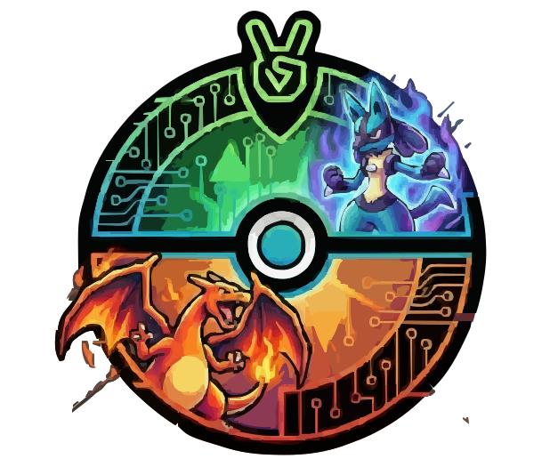

# PokeHub

<p align="center">
  
</p>

**A modern, full-stack Pokemon Showdown clone built with cutting-edge web technologies**

PokeHub is an ambitious recreation of Pokemon Showdown, delivering competitive Pokemon battling and team building experiences with a sleek, modern interface. Built from the ground up using enterprise-grade technologies in an Nx monorepo architecture, this project showcases best practices in full-stack TypeScript development.

## 🚀 Features

- **Team Builder** - Craft competitive Pokemon teams with an intuitive interface
- **Pokemon Explorer** - Browse and discover Pokemon with comprehensive data
- **User Profiles** - Personalized user accounts with OAuth authentication
- **Battle Simulator** - (In Development) Experience strategic Pokemon battles
- **Responsive Design** - Seamless experience across desktop and mobile devices

## 🛠️ Tech Stack

### Frontend

- **Next.js 14** with App Router for modern React development
- **TypeScript** for type-safe code
- **Tailwind CSS** for utility-first styling
- **Radix UI** for accessible component primitives
- **TanStack Query** for powerful data synchronization
- **NextAuth.js v5** for authentication with Google OAuth
- **React Hook Form + Zod** for type-safe form validation

### Backend

- **NestJS** for scalable Node.js server architecture
- **PostgreSQL** with **Drizzle ORM** for type-safe database operations
- **Redis** for real-time battle state, pub/sub, and matchmaking
- **Socket.io** for WebSocket communication
- **@pkmn/sim** for Pokemon Showdown-compatible battle simulation
- **Passport.js** with JWT authentication strategies
- **Winston** for structured logging
- **Azure Blob Storage** for file uploads

### Data Sources

- **@pkmn/dex** & **@pkmn/data** for comprehensive Pokemon information
- **PokeAPI** integration for additional Pokemon data
- **Pokemon Showdown** data for competitive moves and abilities

### Development & Infrastructure

- **Nx** monorepo for efficient build orchestration
- **Jest** & **React Testing Library** for testing
- **Playwright** for end-to-end testing
- **Docker** & **Kubernetes** ready deployment
- **Helm Charts** for container orchestration

## 🏗️ Monorepo Architecture

This project is organized as an Nx monorepo with clear separation of concerns:

- `apps/pokehub-app` - Next.js frontend application
- `apps/pokehub-api` - NestJS backend API
- `packages/frontend/*` - Reusable React/Next.js components and utilities
- `packages/backend/*` - Shared NestJS modules and services
- `packages/shared/*` - Cross-platform models and types

For a comprehensive overview of the system architecture, data flows, and design decisions, see the **[Architecture Documentation](./docs/ARCHITECTURE.md)**.

## 🚦 Quick Start

### Prerequisites

- Node.js 18+
- PostgreSQL database
- Redis (for battle system)
- Google OAuth credentials (for authentication)

### Installation

```bash
npm install
```

### Development

Start both together:

```bash
nx serve pokehub-app pokehub-api
```

The backing services (Postgres, Redis, and admin UIs) run via Docker Compose:

```bash
docker compose -f docker-compose.dev.yaml up -d postgresdb redis
```

Navigate to <http://localhost:4200/> to see the app in action!

#### Fully containerized development (optional)

To run the frontend and backend inside Docker as well — with hot reload via
bind-mounted source — start the whole stack:

```bash
docker compose -f docker-compose.dev.yaml up
```

This builds both apps from `Dockerfile.dev`, runs `nx serve` for each, and wires
them to the `postgresdb` and `redis` services. The frontend is served on
<http://localhost:4200/> and the API on <http://localhost:3000/api>.


## 🧪 Testing

Run all tests:

```bash
nx run-many -t test
```

Test specific projects:

```bash
nx test pokehub-app
nx test pokehub-api
nx test frontend-shared-ui-components
```

## 🏗️ Building

Build for production:

```bash
nx build pokehub-app
nx build pokehub-api
```

Build all projects:

```bash
nx run-many -t build
```

## 📊 Database

Push schema changes:

```bash
npx drizzle-kit push
```

Generate migrations:

```bash
npx drizzle-kit generate
```

For detailed database setup instructions, see [docs/deployment/database.md](./docs/deployment/database.md).

## 📚 Documentation

Comprehensive documentation is available in the `docs/` directory:

- **[Deployment Guide](./docs/deployment/README.md)** - Azure Container Apps deployment
  - [Container Apps Setup](./docs/deployment/container-apps/setup.md)
  - [Operations Guide](./docs/deployment/container-apps/operations.md)
  - [Troubleshooting](./docs/deployment/container-apps/troubleshooting.md)
  - [Database Configuration](./docs/deployment/database.md)
- **[Development Setup](./docs/development/environment-setup.md)** - Environment configuration
- **[Testing](./docs/development/testing/README.md)** - Testing documentation
  - [Unit & Integration Testing](./docs/development/unit-integration-testing.md)
  - [Frontend E2E Testing](./docs/development/testing/frontend-e2e-testing.md)
  - [Backend E2E Testing](./docs/development/testing/backend-e2e-testing.md)
  - [E2E Test Reliability Fixes](./docs/development/testing/e2e-test-reliability-fixes.md) - CI/CD reliability improvements
- **[Features](./docs/features/)** - Feature documentation
  - [Authentication](./docs/features/authentication.md)
  - [Pokedex](./docs/features/pokedex.md)
  - [Team Builder](./docs/features/team-builder.md)
  - [Battle System](./docs/features/battle-system.md) - Real-time battles, matchmaking, WebSocket API

## 🎯 Project Goals

PokeHub aims to:

- Provide a modern alternative to Pokemon Showdown with improved UX
- Demonstrate best practices in monorepo architecture
- Showcase type-safe full-stack development
- Create a highly performant and scalable Pokemon battle platform
- Build a community-driven competitive Pokemon experience

## 🤝 Contributing

Contributions are welcome! This project is actively under development. Please feel free to submit issues and pull requests.

## 📝 License

The source code is licensed under the [MIT License](LICENSE).

**Assets** (including but not limited to logos, images, and graphics in `apps/pokehub-app/public/images/`) are proprietary and may not be used, modified, or distributed for commercial purposes without explicit permission.

Pokemon and related assets are property of Nintendo, Game Freak, and The Pokemon Company.

---

Built with ❤️ using [Nx](https://nx.dev)
